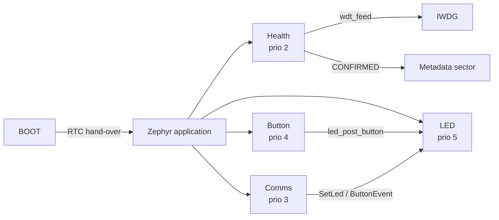

# Architecture

This page explains the Zephyr-specific structure of `app-c-zephyr`: the thread
model, the devicetree overlay, the flash layout and how the image hands back to
the bootloader. It also puts the implementation next to the C FreeRTOS version
so the cost of running the same demo on Zephyr is visible.

## Zephyr building blocks

The application is a freestanding Zephyr project: `CMakeLists.txt` calls
`find_package(Zephyr)`, `prj.conf` holds the Kconfig result and
`boards/nucleo_f767zi.overlay` replaces the board's MCUboot partition layout
with the project bootloader layout. No west workspace is needed to build it.
`scripts/build.sh` configures and builds inside `stm32-dev-zephyr`, and
`scripts/test-ztest.sh` builds the same sources for `native_sim`.

The code is grouped by function rather than by RTOS object:

| Directory | Responsibility |
|---|---|
| `src/board/` | LEDs, button and board I/O |
| `src/boot/` | Hand-over decode, identity and the `CONFIRMED` record |
| `src/comms/` | USART3, HWLINK framing and FlatBuffers commands |
| `src/system/` | Health, watchdog, reset cause, fault record and logging |
| `src/app/` | Shared constants and thread ids |

## Thread model

All four threads are statically defined with `K_THREAD_DEFINE`, so there is no
dynamic thread creation and no application heap.

| Thread | Priority | Stack | Trigger | Responsibility |
|---|---:|---:|---|---|
| Health | 2 | 2048 B | `k_event` / 20 ms loop | check-ins, watchdog feed, trial health check and `CONFIRMED` |
| Comms | 3 | 4096 B | USART3 interrupt / queues | HWLINK framing, FlatBuffers commands, replies and events |
| Button | 4 | 1024 B | GPIO interrupt / 10 ms poll | B1 debounce, short and long press classification |
| LED | 5 | 1024 B | `k_timer` / message queue | LD1/LD2/LD3 patterns and the LD3 health/fault display |

The Health thread is the only watchdog feeder and the only writer of the
`CONFIRMED` record. The LED thread is the only writer of the three LED pins.
The other threads check in with Health; a check-in older than 2 s fails the
health test. `CONFIG_ZDEMO_FAIL_HEALTH=y` forces the failure path so the
bootloader rollback can be tested.



## Devicetree overlay

The stock `nucleo_f767zi` devicetree describes an MCUboot-style flash layout.
The overlay deletes those partitions and installs the project layout:

```dts
&flash0 {
    partitions {
        boot_partition: partition@0     { reg = <0x00000000 0x00008000>; };
        app_meta_partition: partition@8000 { reg = <0x00008000 0x00004000>; };
        slot0_partition: partition@c000  { reg = <0x0000c000 0x000f4000>; };
    };
};
```

The overlay also moves the console and log backend to USART6 and leaves USART3
for HWLINK alone. Unused peripherals are explicitly disabled so a future board
change cannot silently claim a pin. The two build assertions in `main.c` check
that `CONFIG_FLASH_LOAD_OFFSET` and `CONFIG_FLASH_LOAD_SIZE` still agree with
this overlay and with `src/boot/boot_contract.h`.

## Flash and RAM map

BOOT swaps the two 1 MB flash banks, so the running image is always mapped at
`0x08000000` and the same image runs from slot A or B.

| Address | Size | Use |
|---|---:|---|
| `0x08000000` | 32 KB | BOOT, sectors 0..1 |
| `0x08008000` | 16 KB | metadata sector for the running slot |
| `0x0800C000` | 976 KB | application slot / running image |
| `0x08108000` | 16 KB | metadata sector for the other slot |
| `0x0810C000` | 976 KB | application slot in bank 2 |

The application writes only the 32-byte `CONFIRMED` record at offset `0x140`
of the metadata sector. Every other record is BOOT-owned.

## Boot hand-over

1. BOOT writes the hand-over word to `RTC_BKP2R`: magic, slot, trial-pending
   bit and trial counter, then jumps to the image.
2. `main()` bumps the fault boot counter, feeds the watchdog BOOT started and
   captures the reset cause.
3. `app_handover_read()` decodes the hand-over word. A missing record means
   "started without BOOT", so the slot is unknown and no confirmation happens.
4. The health thread waits 5 s, requires five check-ins from each supervised
   thread and checks the free heap. On success it writes `CONFIRMED`; on
   failure it stops feeding the watchdog after 10 s so BOOT rolls back.

The `EnterBootloader` command writes the "stay in BOOT" magic to `RTC_BKP1R`,
sends the Ack and resets; BOOT sees the magic and stays in update mode.

## Why Zephyr differs from the FreeRTOS version

| FreeRTOS concept | Zephyr equivalent used here |
|---|---|
| `xTaskCreate` + task handle | `K_THREAD_DEFINE` static thread |
| `xQueueSend` / `xQueueReceive` | `k_msgq_put` / `k_msgq_get` |
| Task notification | `k_event_set` / `k_event_wait` |
| `xTaskGetTickCount` | `k_uptime_get` |
| `HAL_GPIO_WritePin` | `gpio_pin_set_dt` on a devicetree spec |
| `HAL_NVIC_*` | devicetree interrupt + `gpio_pin_interrupt_configure_dt` |
| FreeRTOS heap statistics | Zephyr thread stack info and no application heap |
| Hand-written board header | devicetree overlay and `Kconfig` |

The result is less board code and more configuration. The trade-off is that
the behaviour is split between `prj.conf`, the overlay and the C sources, which
is why both are checked by the boot-contract CI stage and the architecture
notes above.

## Side-by-side with `app-c-freertos`

Both images implement the same demo, the same HWLINK schema and the same
bootloader contract. Sizes were measured from the release builds with
`arm-none-eabi-size`; the flash figure is `text + data`, RAM is `data + bss`.

| Metric | C FreeRTOS | C Zephyr |
|---|---:|---:|
| Kernel | FreeRTOS | Zephyr 4.4.2 |
| Flash used | 43,072 B | 69,088 B |
| RAM used (static) | 61,924 B | 50,218 B |
| Application source lines | ~4,200 | ~2,300 |
| Threads/tasks | 4 | 4 |
| Watchdog | single Health feeder | single Health feeder |
| Boot hand-over | `RTC_BKP2R` | `RTC_BKP2R` |
| HWLINK schema | shared `protocol/hwlink.fbs` | shared `protocol/hwlink.fbs` |
| Unit tests | host C tests for CRC/HWLINK | `ztest` on `native_sim` |

Zephyr spends more flash on the kernel, drivers and logging, and uses less
static RAM because the kernel objects are smaller than the FreeRTOS heap plus
task stacks. The smaller source count is mostly devicetree and Kconfig taking
over work that the FreeRTOS version does in C.

## Configuration

| Option | Default | Effect |
|---|---:|---|
| `CONFIG_ZDEMO_FAIL_HEALTH` | `n` | Force the trial health check to fail and exercise rollback |
| `CONFIG_ZDEMO_LOG_LEVEL` | `3` | Application log severity (0 off .. 4 debug) |
| `CONFIG_ZDEMO_WATCHDOG_TIMEOUT_MS` | `4000` | IWDG timeout installed by `app_wdt_init()` |
| `CONFIG_LOG_DEFAULT_LEVEL` | `3` | Zephyr kernel/driver log severity |
| `CONFIG_LOG_MODE_DEFERRED` | `y` | Log from a deferred thread, never block a thread on UART |

Use `make menuconfig` to change them interactively, or edit `prj.conf` for a
build that must be reproducible from the repository.

## Tests

`tests/hwlink/` is a Zephyr `ztest` suite that links the real
`src/comms/hwlink.c`. It covers the CRC check value, the COBS examples, the
253/254/255-byte block boundaries and the rejection paths (bad CRC, reserved
flags, embedded zero, truncated block). `make test` builds it for `native_sim`
and runs the resulting host executable, so it needs no board and no emulator.

## Where to look

| Topic | Source |
|---|---|
| Kconfig options | `Kconfig`, `prj.conf` |
| Devicetree overlay | `boards/nucleo_f767zi.overlay` |
| Boot contract | `src/boot/boot_contract.h` |
| Hand-over record | `src/boot/handover.c` |
| Health and confirmation | `src/system/health.c` |
| HWLINK framing | `src/comms/hwlink.c` |
| HWLINK commands | `src/comms/comms.c` |
| Tests | `tests/hwlink/`, `scripts/test-ztest.sh` |
